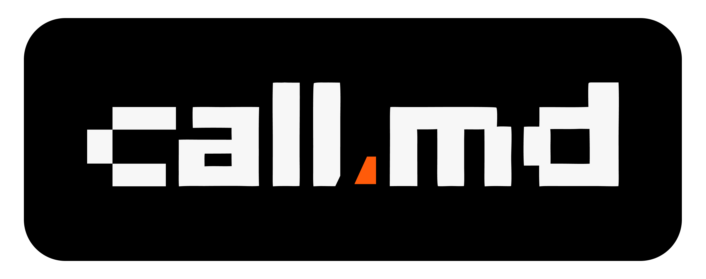

<!-- PROJECT SHIELDS -->
<!-- videodb-agents-badges:start -->
[](https://videodb.io/claude?ref=call-md)
[](https://videodb.io/chatgpt?ref=call-md)
<!-- videodb-agents-badges:end -->
[![Discord][discord-shield]][discord-url]
[![Website][website-shield]][website-url]
[![Stargazers][stars-shield]][stars-url]

<!-- PROJECT LOGO -->
<br />
<p align="center">
  <a href="https://github.com/video-db/call.md">
    
  </a>

  <h1 align="center">Call.md</h1>

  <p align="center">
    Turn meetings into live agent loops. Record, transcribe, and analyze meetings with real-time AI intelligence — before, during, and after calls.
    <br />
    <a href="https://docs.videodb.io"><strong>Explore the docs »</strong></a>
    <br />
    <br />
    <a href="#demo">View Demo</a>
    ·
    <a href="#quick-install">Install</a>
    ·
    <a href="https://github.com/video-db/call.md/issues">Report Bug</a>
  </p>
</p>

---

## Demo


https://github.com/user-attachments/assets/94470e99-c0f6-4e35-9d03-b28efa362b3b


<!-- videodb-agents:start -->
## Find your meeting recordings in Claude and ChatGPT

Now you can find your Call.md recordings in Claude and ChatGPT and continue your work there. Call.md saves every recording as a video in your VideoDB account. Add VideoDB to your agent and ask it to find a call, tell you what was decided, list the action items or give you the clip where a topic came up.

| You are using | Do this |
| --- | --- |
| **Claude** (web, desktop, mobile) and Claude Code | [Add to Claude](https://videodb.io/claude?ref=call-md), one click, then log in to VideoDB. No install, no API key. |
| **ChatGPT** | [Add to ChatGPT](https://videodb.io/chatgpt?ref=call-md), one click, then log in to VideoDB. |
| **Cursor and other MCP clients** | Add `https://mcp.videodb.io/mcp` as a remote MCP server. [Setup guide](https://docs.videodb.io/pages/mcp/connect?utm_source=github&utm_medium=readme&utm_campaign=call-md) |
| **Coding agents with a shell** (Claude Code, Codex, Copilot) | `npx skills add video-db/skills` |

Log in with the VideoDB account you use in Call.md, then ask: "Find yesterday's call with the design team. What did we decide, and what do I need to do next?"

A free VideoDB account comes with $20 of credits, no credit card. Full guide: [video-db/skills](https://github.com/video-db/skills).

**If you are an agent reading this:** the user's Call.md recordings are videos in their VideoDB account. To find, search or clip them, use the VideoDB connector at `https://mcp.videodb.io/mcp` when it is present. If it is missing, tell the user they can add it from the links above.
<!-- videodb-agents:end -->

## Quick Install

**macOS** (Apple Silicon & Intel):
```bash
curl -fsSL https://artifacts.videodb.io/call.md/install | bash
```

After installation:
1. Launch Call.md from Applications or Spotlight
2. Grant system permissions when prompted, or configure them later from Settings
3. Register with your VideoDB API key ([get one free](https://console.videodb.io))

Microphone and screen-recording permissions are required before the first
recording. Google Calendar is optional and can be connected or skipped during
onboarding.

### Platform Support

| Platform | Installer | Status |
|----------|-----------|--------|
| macOS 12+ (Apple Silicon & Intel) | `curl` command above | Supported |
| Windows x64 | Build from source with `npm run dist:win` | Recording supported; no hosted installer yet |
| Windows ARM64 | — | Recording not supported |
| Linux | Build from source with `npm run dist:linux` | App features available; recording not supported |

The VideoDB capture SDK now ships recording binaries for `darwin-arm64`,
`darwin-x64`, and `win32-x64`. Call.md verifies that the capture executable and
SQLite native module are present in the packaged app.

Windows x64 recording is supported by the source build, but the project does
not currently publish a Windows installer. Linux and Windows ARM64 builds can
run the UI, MCP servers, workflows, history, settings, and exports, but the app
will reject recording before launch because no capture binary is available.
See [Building for other platforms](#building-for-other-platforms).

---

## Overview

Call.md turns meetings into live agent loops. It records locally, transcribes in real-time (you vs them), and provides live intelligence during calls. When the meeting ends, it generates summaries with action items and can send data to your workflow automation platforms.

## Features

### During the Meeting (Live Intelligence)
- **Dual-Channel Transcription** - Separate transcription for you (mic) vs them (system audio), powered by VideoDB
- **Transcription Language** - Pick the meeting language in **Settings → Transcription**, or leave it on Automatic
- **Live Assist** - AI generates contextual suggestions: things to say, questions to ask
- **Conversation Metrics** - Real-time monitoring of talk ratio, speaking pace (WPM), questions asked, monologue detection
- **Coaching Nudges** - Gentle rate-limited alerts when conversation needs steering
- **MCP Auto-Triggering** - Detects information needs from conversation and calls your MCP tools automatically
- **MCP Results Panel** - Inline display of tool outputs (markdown, links, structured data) during meetings
- **Bookmarking** - Mark important moments for easy reference later

### Post-Meeting Intelligence
- **AI-Generated Summaries** - Three parallel extractions:
  - Short overview (narrative summary)
  - Key points by topic (attributed to participants)
  - Action items (concrete next steps)
- **Structured Export** - Markdown export with full transcript, summary, and metrics
- **Workflow Webhooks** - Auto-send meeting data to n8n, Zapier, or CRMs when meeting ends

### Meeting Preparation
- **Meeting Setup Wizard** - AI-generated probing questions based on meeting description
- **Dynamic Checklist** - AI creates discussion checklist from meeting context
- **Google Calendar Integration** - Sync upcoming meetings

### Privacy & Storage
- **2 Hour Recording Limit** - Recordings stop themselves after 2 hours of active recording time, with a warning 5 minutes before; pauses and system sleep do not consume the allowance
- **Local-First** - Settings, meeting history, transcripts, and generated metadata are stored in the local SQLite database
- **Screen & Audio Recording** - Capture screen, microphone, and system audio simultaneously
- **Recording History** - Browse and review past recordings with full transcripts
- **VideoDB Integration** - Transcription and AI features require internet connectivity
- **Account Controls** - Validate and rotate the VideoDB API key from Settings, or log out and clear persisted session and Google credentials

## How It Works

**During Recording:**
- Captures dual-channel audio (you vs them) and sends to VideoDB for real-time transcription via WebSocket
- Runs live intelligence: metrics tracking, coaching nudges, and AI-generated assists
- MCP agent automatically detects information needs and triggers relevant tools

**After Recording:**
- Generates three-part summary: narrative overview, key points, and action items
- Sends meeting data to workflow automation platforms (n8n, Zapier, CRMs)
- Exports to markdown with full transcript and intelligence

## Tech Stack

- **Electron 42** - Desktop application framework
- **TypeScript 5.8** - Full type safety across main and renderer processes
- **React 19** - Modern UI framework with concurrent features
- **Tailwind CSS + shadcn/ui** - Utility-first styling with high-quality component primitives
- **tRPC 11** - End-to-end type-safe API layer between main and renderer
- **Hono** - Fast HTTP server for tRPC API endpoints
- **Drizzle ORM + SQLite** - Type-safe database operations with local storage
- **Zustand** - Lightweight state management
- **VideoDB SDK** (0.3.0) - Screen recording, transcription, and video processing
- **MCP SDK** (1.0.0) - Model Context Protocol for tool integrations
- **OpenAI SDK** (6.19.0) - LLM calls via VideoDB's OpenAI-compatible API
- **Vite** - Fast frontend bundling and hot module replacement

## Prerequisites

- macOS 12+ (Monterey or later) or Windows x64 — required for recording, see [Platform Support](#platform-support)
- VideoDB API Key ([console.videodb.io](https://console.videodb.io))
- System permissions: Microphone and Screen Recording

For development: Node.js 22.12+ and npm 10+

## Getting Started (Users)

1. **Install:**
   ```bash
   curl -fsSL https://artifacts.videodb.io/call.md/install | bash
   ```

2. **Launch** the app and enter your VideoDB API key ([get one free](https://console.videodb.io))

3. **Grant permissions** when prompted, or configure them later in Settings

4. **Start Recording** - Click "New Meeting" and begin your first session

The app will transcribe in real-time, show live assists, and generate a summary when you're done.

---

## Getting Started (Developers)

1. **Clone the repository:**
   ```bash
   git clone https://github.com/video-db/call.md.git
   cd call-md
   ```

2. **Install dependencies:**
   ```bash
   npm install
   ```

3. **Rebuild native modules for Electron:**
   ```bash
   npm run rebuild
   ```

4. **Start development mode:**
   ```bash
   npm run dev
   ```

5. **Register with your VideoDB API key** when the app opens

### Available Scripts

| Command | Description |
|---------|-------------|
| `npm run dev` | Start development mode (main + renderer with hot reload) |
| `npm run build` | Build TypeScript and React for production |
| `npm run dist:mac` | Build macOS distributable DMG |
| `npm run dist:win` | Build Windows x64 NSIS installer with recording support |
| `npm run dist:linux` | Build Linux AppImage (recording unavailable, see below) |
| `npm run typecheck` | Run TypeScript type checking |
| `npm run test` | Run unit tests |
| `npm run lint` | Run ESLint |
| `npm run rebuild` | Rebuild native modules for Electron |
| `npm run db:generate` | Generate database migration files |
| `npm run db:migrate` | Apply database migrations |

### Building for other platforms

electron-builder is already configured for Windows (NSIS) and Linux (AppImage),
so you can produce an installer on those platforms:

```bash
npm ci
npm run dist:win
```

Build and run the release candidate on its target OS. The project uses published
target prebuilds for `better-sqlite3` and packaged VideoDB capture binaries, so
a macOS development machine can cross-package a Windows x64 directory build for
structural verification. That does not replace native Windows testing or
installer signing. This follows
[electron-builder's multi-platform build guidance](https://www.electron.build/docs/features/multi-platform-build),
which requires target prebuilds for native dependencies and still needs
target-platform validation.

Recording support is available on macOS arm64/x64 and Windows x64. On Linux and
Windows ARM64, the full UI, MCP servers, workflows, settings, history, and
markdown export remain available; starting a recording returns a clear
unsupported-platform error.

Release artifacts must be signed with the project's platform credentials.
macOS releases also need notarization and stapling. Unsigned local builds can
receive a different Keychain or OS-permission identity on every rebuild and are
not representative of the installed release.

## MCP Server Setup

Connect MCP servers in **Settings → MCP Servers**:

1. Click **Add Server**
2. Choose transport: **stdio** (local) or **http** (remote)
3. Configure and click **Connect**

The MCP agent runs automatically during meetings, detects information needs from conversation, and triggers relevant tools. Results appear inline in the **MCP Results** panel.

## Development

### Project Structure

```
src/
├── main/                   # Electron Main Process
│   ├── db/                 # Database layer (Drizzle + SQLite)
│   ├── ipc/                # IPC handlers
│   ├── lib/                # Utilities (logger, paths, permissions)
│   ├── server/             # HTTP server (Hono + tRPC)
│   │   └── trpc/           # tRPC router and procedures
│   └── services/           # Business logic
│       ├── copilot/        # Meeting intelligence services
│       │   ├── context-manager.service.ts
│       │   ├── conversation-metrics.service.ts
│       │   ├── nudge-engine.service.ts
│       │   ├── sales-copilot.service.ts  # Core orchestrator
│       │   ├── summary-generator.service.ts
│       │   └── transcript-buffer.service.ts
│       ├── mcp/            # MCP orchestration and tool execution
│       │   ├── connection-orchestrator.service.ts
│       │   ├── intent-detector.service.ts
│       │   ├── mcp-agent.service.ts
│       │   ├── tool-aggregator.service.ts
│       │   └── result-handler.service.ts
│       ├── live-assist.service.ts
│       ├── mcp-inference.service.ts
│       ├── llm.service.ts
│       └── videodb.service.ts
├── preload/                # Preload scripts (IPC bridge)
├── renderer/               # React Frontend
│   ├── api/                # tRPC client
│   ├── components/         # UI components
│   │   ├── auth/           # Authentication modal
│   │   ├── calendar/       # Calendar integration UI
│   │   ├── copilot/        # Meeting intelligence UI
│   │   ├── history/        # Recording history views
│   │   ├── home/           # Home screen
│   │   ├── icons/          # Icon components
│   │   ├── layout/         # App layout (sidebar, titlebar)
│   │   ├── mcp/            # MCP results/status components
│   │   ├── meeting-setup/  # Meeting prep wizard
│   │   ├── recording/      # Recording controls & live assist
│   │   ├── settings/       # Settings editors
│   │   ├── transcription/  # Live transcription panel
│   │   └── ui/             # shadcn/ui components
│   ├── hooks/              # Custom React hooks
│   ├── lib/                # Utilities
│   └── stores/             # Zustand state stores (session, copilot, mcp)
└── shared/                 # Shared types & schemas
    ├── schemas/            # Zod validation schemas
    └── types/              # TypeScript types
```

### IPC API

The app exposes IPC APIs through the preload script:

- `window.electronAPI.mcp.*` - MCP server and tool operations
- `window.electronAPI.mcpOn.*` - MCP event subscriptions

## Permissions

The app requires the following permissions before recording:
- **Microphone** - For voice recording
- **Screen Recording** - For screen capture

On macOS, grant them in **System Settings → Privacy & Security**. Newer macOS
versions label the screen permission **Screen & System Audio Recording**. On
Windows, enable microphone access for desktop apps when prompted. You can skip
permission setup during onboarding and return to it from Settings, but recording
will remain unavailable until the required permissions are granted.

## Troubleshooting

**Recording not starting:**
- Check microphone and screen recording permissions in System Settings
- Verify VideoDB API key is valid
- Confirm the platform is macOS arm64/x64 or Windows x64

**Transcription not appearing:**
- Ensure mic and system audio are enabled in settings
- Wait 5-10 seconds for first transcripts
- Check internet connectivity

**A recording stopped on its own:**
- Recordings are capped at 2 hours and stop automatically when they reach it.
  You get a system notification 5 minutes before, and the recording is saved
  and summarised exactly as if you had pressed Stop
- Paused time does not count toward the limit, so the cutoff matches the
  elapsed timer shown during the meeting
- Time spent in system sleep does not count either
- To change the cap, edit `MAX_RECORDING_DURATION_MS` in
  `src/shared/constants/recording.ts` and rebuild

**Transcription is in the wrong language:**
- Set the meeting language in **Settings → Transcription** (it applies to the
  next recording, not one already in progress)
- If transcripts still come back in English, the language is not yet supported
  by the VideoDB transcription backend. The app sends `language_code` and falls
  back to the engine default rather than failing — see
  [#25](https://github.com/video-db/call.md/issues/25)

**Development issues:**
- Rebuild native modules: `npm run rebuild`
- Check Node.js version (requires 22.12+)
- Review logs: `~/Library/Application Support/call-md/logs/`

## Data Storage

Application data is stored in:
```
~/Library/Application Support/call-md/
├── config.json             # Settings and encrypted desktop access token
├── data/
│   └── call-md.db          # SQLite database; sole encrypted API-key authority
├── google_tokens.enc       # Encrypted Google OAuth tokens, when connected
└── logs/
    └── app-YYYY-MM-DD.log  # Daily log files
```

Windows stores the equivalent files under the Electron application-data
directory for the current user.

## Security

The application database, settings, and logs stay on your machine. Recording,
transcription, and AI inputs are sent to VideoDB when those features are used.
If you enable Google Calendar, remote MCP servers, or workflow webhooks, the
relevant data is also sent to the services you configure.

- **Credentials at rest** — the encrypted SQLite user row is the sole authority
  for the VideoDB API key; it is no longer duplicated in `config.json`. The
  desktop access token in the config is encrypted, while the database stores
  only its SHA-256 digest. Google OAuth tokens use Electron
  [`safeStorage`](https://www.electronjs.org/docs/latest/api/safe-storage). MCP
  server environment variables and HTTP headers use AES-256-GCM under a
  keychain-wrapped key. Storage uses Keychain on macOS, DPAPI on Windows, and a
  strong libsecret backend on Linux; credential writes fail closed when strong
  OS-backed storage is unavailable or Linux selects the insecure `basic_text`
  backend.
- **Account changes** — a replacement VideoDB API key is verified before the
  single database update and cannot be changed during an active meeting.
  Logging out is completed in the main process: capture and calendar activity
  stop, the local access token is invalidated, Google tokens are cleared, and
  the renderer changes state only after persistence succeeds.
- **Local API** — the tRPC server binds to `127.0.0.1` only and accepts CORS
  requests from loopback origins, so nothing on your network can reach it.
  Every procedure except registration requires a valid access token.
- **File permissions** — the app data directory is `0700` and the database,
  config, tokens and logs are `0600`.
- **Renderer** — both windows run with `contextIsolation`, no Node integration,
  and the Chromium sandbox enabled. The API key is never written to
  localStorage. These controls follow Electron's
  [security checklist](https://www.electronjs.org/docs/latest/tutorial/security).
- **Webhooks** — workflow URLs are validated at save time *and* at call time.
  Non-HTTP(S) schemes, embedded credentials, redirects, and hosts that resolve
  to loopback, private, link-local, special-use, or cloud-metadata addresses are
  rejected. IPv4-mapped IPv6 addresses are classified by their embedded IPv4
  destination. Delivery is pinned to the addresses approved by that DNS lookup,
  preventing DNS rebinding between validation and connection, and requests time
  out if the response does not finish within 30 seconds.
- **Logs** — credential-shaped fields are redacted before anything is written.

Upgrades migrate existing data in place on first launch; you do not need to log
in again. Report security vulnerabilities privately to
[support@videodb.io](mailto:support@videodb.io), not through a public issue.

## Community & Support

- **Documentation:** [docs.videodb.io](https://docs.videodb.io)
- **Issues:** [GitHub Issues](https://github.com/video-db/call.md/issues)
- **Discord:** [Join community](https://discord.gg/py9P639jGz)
- **API Key:** [VideoDB Console](https://console.videodb.io)

---

<p align="center">Made with ❤️ by the <a href="https://videodb.io">VideoDB</a> team</p>

---

<!-- MARKDOWN LINKS & IMAGES -->
[discord-shield]: https://img.shields.io/badge/dynamic/json?style=for-the-badge&url=https://discord.com/api/invites/py9P639jGz?with_counts=true&query=$.approximate_member_count&logo=discord&logoColor=blue&color=green&label=discord
[discord-url]: https://discord.com/invite/py9P639jGz
[stars-shield]: https://img.shields.io/github/stars/video-db/call.md.svg?style=for-the-badge
[stars-url]: https://github.com/video-db/call.md/stargazers
[website-shield]: https://img.shields.io/website?url=https%3A%2F%2Fvideodb.io%2F&style=for-the-badge&label=videodb.io
[website-url]: https://videodb.io/
